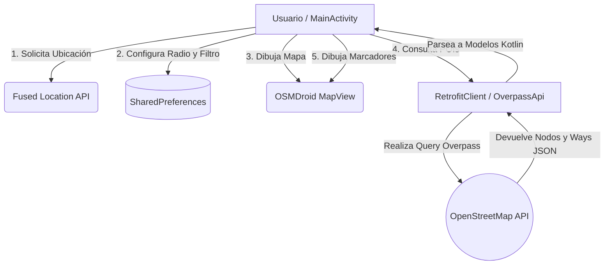

<div align="center">
  
  <h1>🚜 Reto 9: Accediendo al GPS y Puntos de Interés (Sector Agroindustrial) 🌾</h1>
  <p><strong>Desarrollo de Aplicaciones para Dispositivos Móviles</strong></p>

  [](https://kotlinlang.org)
  [](https://developer.android.com/studio)
  [](https://osmdroid.github.io/osmdroid/)
  [](https://wiki.openstreetmap.org/wiki/Overpass_API)
</div>

<hr/>

## 📖 Descripción del Proyecto

Esta aplicación de Android demuestra cómo **acceder a la ubicación GPS** del dispositivo y presentar en un mapa los **Puntos de Interés (POIs)** cercanos dentro de un radio configurable en kilómetros. 

De acuerdo con el desafío planteado, esta solución utiliza **OpenStreetMap (OSMDroid)** y la **Overpass API**, ofreciendo una alternativa robusta, libre y sin costes de facturación en comparación con Google Maps.

¡Hemos llevado este reto más allá! La temática está **enfocada en el sector agroindustrial**. A través de la aplicación, el usuario puede explorar:
- 🌱 **Cultivos:** Zonas agrícolas, granjas y huertos.
- 🏭 **Procesamiento de Alimentos:** Fábricas e instalaciones industriales de grado alimentario.
- 🏢 **Almacenamiento:** Silos y grandes almacenes.

Permitiendo visualizar un flujo lógico o "recorrido" del sector agroalimentario en la zona geográfica consultada.

<br/>

## 🛠️ Tecnologías Utilizadas

- **Lenguaje:** Kotlin
- **Mapas:** [OSMDroid](https://github.com/osmdroid/osmdroid) (Librería open-source para visualizar mapas OSM en Android).
- **Consumo de API:** [Retrofit](https://square.github.io/retrofit/) y [Gson](https://github.com/google/gson) para parsear los datos geográficos de Overpass API.
- **Ubicación:** `play-services-location` (Fused Location Provider) para una obtención de coordenadas rápida y precisa.
- **Persistencia:** `SharedPreferences` para guardar el radio de búsqueda seleccionado por el usuario.

<br/>

## 🏗️ Estructura y Arquitectura



### 📁 Estructura del Código
```text
com.example.reto9
 ┣ 📂 data
 ┃ ┣ 📄 OverpassApi.kt (Interfaz de Endpoints)
 ┃ ┣ 📄 OverpassResponse.kt (Modelos de Datos - POJOs)
 ┃ ┗ 📄 RetrofitClient.kt (Instancia Singleton de Retrofit)
 ┣ 📂 utils
 ┃ ┗ 📄 PreferencesManager.kt (Gestión del Radio y Filtros)
 ┗ 📄 MainActivity.kt (Actividad Principal con UI del Mapa)
```

<br/>

## 🔗 Repositorios Anteriores
Puedes revisar el progreso del desarrollo de los retos anteriores aquí:
- [Reto 7](https://github.com/jf-floresriera/Reto7)
- [Reto 8](https://github.com/jf-floresriera/Reto8)
- **[Reto 9 (Actual)](https://github.com/jf-floresriera/Reto9)**

<br/>

## 🚀 Instalación y Uso

1. **Clonar el repositorio:**
   ```bash
   git clone https://github.com/jf-floresriera/Reto9.apk
   ```
2. **Abrir en Android Studio:** Asegúrate de tener conexión a Internet para que Gradle descargue las dependencias (OSMDroid, Retrofit, Play Services).
3. **Sincronizar Gradle** y ejecutar el proyecto en un emulador o dispositivo físico.
4. **Al abrir la app:** 
   - Concede el permiso de ubicación.
   - El mapa se centrará en tu posición actual.
   - Usa el **Spinner superior** para filtrar por *Cultivos*, *Procesamiento* o *Almacenamiento*.
   - Usa el **botón de Ajustes (⚙️)** en la parte superior para deslizar el Slider y elegir un radio de búsqueda entre 1 km y 50 km. 

*(Nota: En áreas muy urbanizadas o muy rurales extremas, los resultados de la etiqueta `landuse=farmland` pueden variar, depende del mapeo comunitario local de OSM).*

<br/>

<div align="center">
  <b>Desarrollado con 💪 por Jesús Flores</b>
</div>
